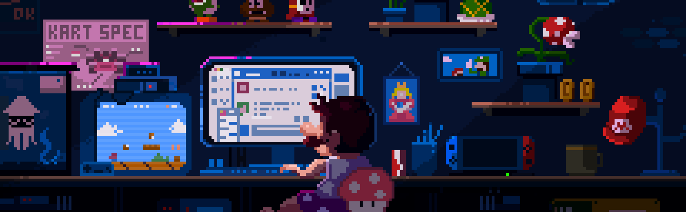

  

<h1 align="center">Rushikesh Jadhav</h1>

<b>Software Engineer</b> &nbsp;·&nbsp; Systems, Android and Applied ML

  

  
  
  
  
  

BTech student who builds full-stack products end to end, mostly in **TypeScript**, **Next.js** and **Convex**, with a growing focus on AI: computer vision, browser agents and on-device models.

<!-- Add your college / year / CGPA here if you want, e.g.:
BTech in <Branch> at **<College>** (class of 20XX). -->

 

## Selected work

**[CAMX](https://github.com/LordRushii/Camx)**: an AI-powered surveillance platform. On-device ONNX vision models (RF-DETR, YOLO) detect threats across a camera network in real time, and a two-pass LLM check confirms each one before an alert fires. Uploaded footage gets frame scoring, an AI-written timeline and RAG chat for asking questions about what happened.
`TypeScript` · `ONNX` · `YOLO / RF-DETR` · `Convex` · `RAG`

**[Orka](https://github.com/LordRushii/orka)**: an on-device privacy browser agent. It reads the active webpage, redacts sensitive data locally, and runs only validated, user-authorized browser actions through a configurable VLM/LLM planner.
`TypeScript` · `Manifest V3` · `Bun` · `LLM / VLM`

**[Localum](https://github.com/LordRushii/Localum)**: a fully offline AI image generator for the desktop. Powered by QVAC, it runs SD 2.1, SDXL and Flux.2 on your local GPU/CPU with zero cloud dependencies.
`TypeScript` · `QVAC` · `Stable Diffusion` · `Flux`

**[Tackbox](https://github.com/LordRushii/TackBox)** · [live](https://tackbox.vercel.app): GitHub for AI agent skills. Write skills in Markdown, publish them publicly or privately, and reuse them anywhere.
`Next.js 16` · `React 19` · `Convex` · `Tailwind v4`

**[Pullstore](https://github.com/LordRushii/pullstore)** · [live](https://pullstore.vercel.app/): a modern e-commerce app with auth and an admin side.
`React` · `Vite` · `MongoDB` · `Better Auth`

<!-- Optional "Also" section: add achievements, hackathons, internships, LeetCode etc.
## Also

- ...
-->

## Stack

   
   
  

Also: Convex · shadcn/ui · Zod · Groq · Gemini · Playwright · Vitest · Clarity (Web3)

## Activity

  <picture>
    <source media="(prefers-color-scheme: dark)" srcset="https://streak-stats.demolab.com/?user=LordRushii&hide_border=true&background=0D1117&stroke=30363D&ring=3B82F6&fire=3B82F6&currStreakNum=C9D1D9&sideNums=C9D1D9&currStreakLabel=3B82F6&sideLabels=8B949E&dates=8B949E">
    <source media="(prefers-color-scheme: light)" srcset="https://streak-stats.demolab.com/?user=LordRushii&hide_border=true&background=FFFFFF&stroke=E5E7EB&ring=3B82F6&fire=3B82F6&currStreakNum=1F2328&sideNums=1F2328&currStreakLabel=3B82F6&sideLabels=57606A&dates=57606A">
    
  </picture>

  <picture>
    <source media="(prefers-color-scheme: dark)" srcset="https://raw.githubusercontent.com/LordRushii/LordRushii/output/pacman-contribution-graph-dark.svg?v=2">
    <source media="(prefers-color-scheme: light)" srcset="https://raw.githubusercontent.com/LordRushii/LordRushii/output/pacman-contribution-graph.svg?v=2">
    
  </picture>

Open to SDE roles and internships · <a href="mailto:rushi.jadhav.cs@gmail.com">rushi.jadhav.cs@gmail.com</a>

